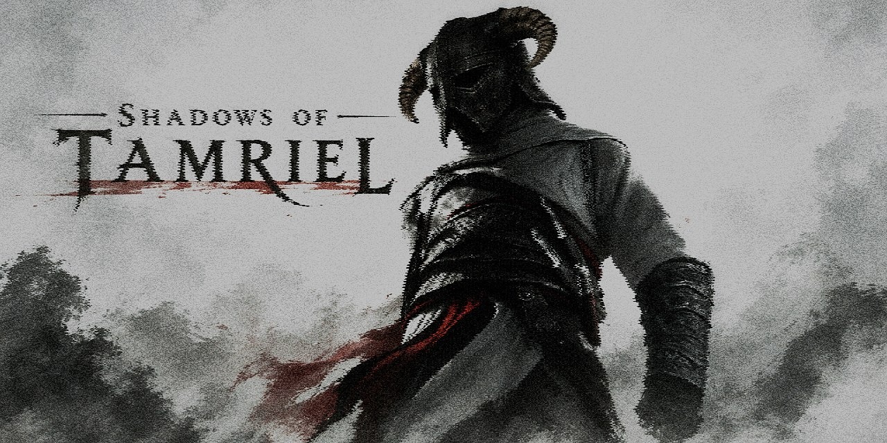
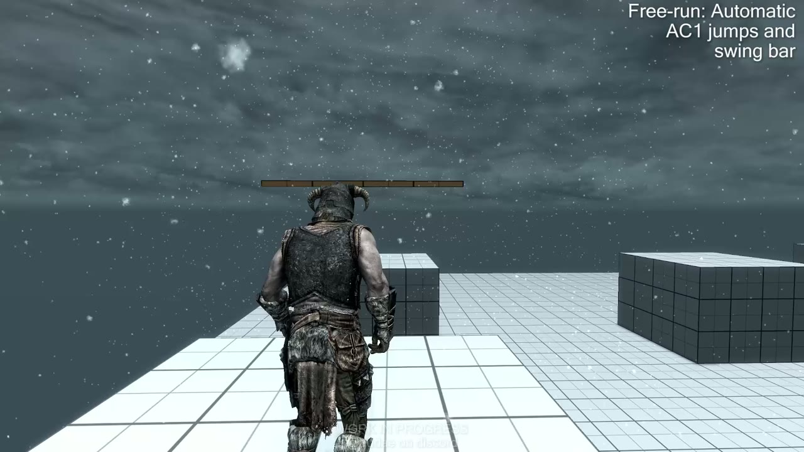

# Shadows of Tamriel

*Assassin's Creed 1's Altaïr, in Skyrim.*

**Work in progress.** Assassin's Creed 1's movement, native in Skyrim SE/AE: your character stays a normal Skyrim
character (physics, camera, combat, saves) but moves, free-runs and takes leaps of faith like Altaïr.

Built on **[AC1 Movement Rewritten](https://github.com/Banned445/AC1-Movement-Rewritten)**, an open-source
reverse-engineered rewrite of AC1's movement. Its research is what makes the free-running behave like AC1: how the
game finds jump targets, its 13 reach zones, how it picks and blends its jump items and corrects the root onto the
target, ledges, beams, wall runs and swings. Animations and sounds come from **your own copy of AC1**, extracted and
retargeted to the Skyrim skeleton by the tools here.

> This repository contains **code and tools only**. It does not include any Assassin's Creed or Skyrim game files,
> extracted animations, sounds, textures or meshes. Everything game-derived is generated locally from your own
> legitimate copies of the games.

## Demo

*Click the image to watch the greybox demo (1080p, 1:26).*

## What's in it

| Part | What it does |
|---|---|
| **AC1 locomotion** (OAR) | Idle, walk / run / sprint in every direction, turns, jumps, sneaking + roll, one-handed sword combat — Open Animation Replacer configs in [`oar/`](oar/), animations generated by `tools/retarget_ac1_v2.py`. |
| **AC1 parkour** (SkyParkour) | AC1 vault / climb / land-roll animations for SkyParkour. |
| **Leap of faith** | Haystacks that arm AC1's swan dive when you stand high above them, the AC1 eagle cry and wind, a soft landing, a *Place Haystack* power, hiding inside the haystack and hopping out. Papyrus in [`papyrus/`](papyrus/), plugin built by `tools/build_lof_esp.py`. |
| **Free-running** — `AltairFreerun.dll` | SKSE plugin (C++ / CommonLibSSE-NG) in [`freerun/`](freerun/): finds AC1-style jump targets with Havok rays, scores them like AC1, and plays AC1's own takeoff / flight / reception clips through its own pose player with the root locked onto the target. Left / right-foot and angled (side / back) takeoffs, fast landings, ledges (catch, hang, shimmy, pull up, drop), beams (crouched balance walk), poles, swing bars (pumped with W / S), wall run up, AC1's blend prayer on **B** (with the eyes closing), and viewpoint synchronization (**B** at a leap point: crouch, eagle cry, camera sweep). See [`docs/AC1_FREERUN_PLAN.md`](docs/AC1_FREERUN_PLAN.md). |
| **Settings** — `AltairAC1Menu.dll` | The *Shadows of Tamriel* pages in SKSE Menu Framework (Rust, no CommonLib) for the leap-of-faith and animation settings; the free-run plugin adds its own page. |
| **Greybox** | An interior test cell under Skyrim's sky (`coc AltairFreerunGraybox`) with AC1's jump distances, height changes, beams, poles, a swing bar, ledge walls, wall-run walls and a leap-of-faith tower — built by `tools/build_graybox_nifs.py` + `tools/build_graybox_esp.py`. |

## Requirements

Games: a legitimate PC copy of **Skyrim Special Edition / Anniversary Edition** and of **Assassin's Creed (Director's Cut)**.

Required Skyrim mods (latest versions; SKSE must match your Skyrim version):

- SKSE
- Address Library for SKSE Plugins
- Open Animation Replacer
- PapyrusUtil
- SKSE Menu Framework (the in-game settings pages)

Optional:

- SkyParkour, plus Pandora or Nemesis to generate its behaviors: only for the AC1 vault / climb / landing-roll
  animations. Free-running, ledges, beams and the leap of faith work without it.
- True Directional Movement: recommended for AC1-style movement.

Tools: Rust, Visual Studio 2022+ Build Tools with CMake, vcpkg, Blender 5.x with PyNifly, Python 3, the Creation Kit's
Papyrus compiler.

## Building (outline)

1. **Extract AC1 clips** from your install: `tools/ac1_anim_export` (Rust; compiles AC1 Movement Rewritten's forge /
   animation decoders read-only) with a clip list from [`specs/`](specs/):
   `ac1_anim_export <AC1 dir> ac1_clips_fr.json specs/ac1_spec_fr.json`.
2. **Retarget** to the Skyrim skeleton in Blender: `ALTAIR_JOBSET=<jobset> blender -b --python tools/retarget_ac1_v2.py -- <clips.json> <vanilla anims dir> <out dir>`
   (job sets: default locomotion, `parkour`, `jumps`, `leap`, `freerun`).
3. **Pack** the free-run clips for the plugin: `blender -b --python tools/pack_freerun.py -- ac1_clips_fr.json build_fr AltairFreerun.pack`.
4. **Plugins**: `tools/build_lof_esp.py`, `tools/build_graybox_esp.py`; Papyrus: `tools/compile_lof.sh`.
5. **SKSE plugins**: `freerun/` with CMake presets (CommonLibSSE-NG + vcpkg); `tools/altair_menu` with `cargo build --release`.

Paths in the scripts are currently those of the author's machine; adjust them to yours.

## Status

Work in progress — expect rough edges. Coming next: AC1's climbing grid,
air assassinations, Eagle Vision, blending into crowds, and a one-click "build from your own copies"
installer.

## Disclaimer

This is an unofficial fan project and is not affiliated with, endorsed by, or associated with Ubisoft or Bethesda.
The project does not distribute original Assassin's Creed or Skyrim game files or assets. Users must provide their
own legitimate copies of the games where original game data is required.
